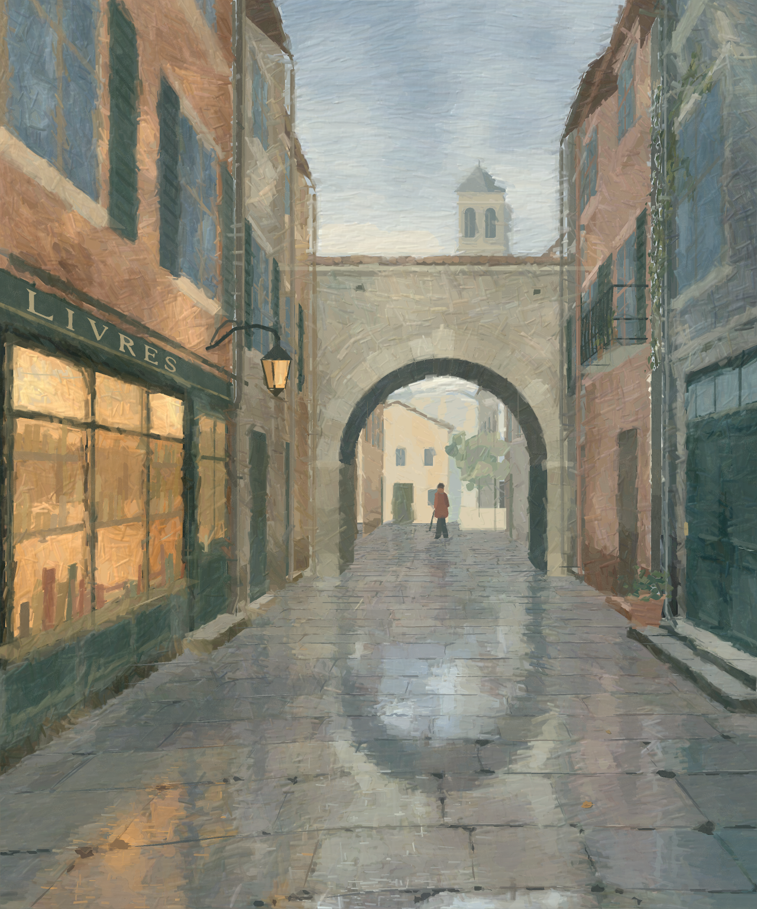
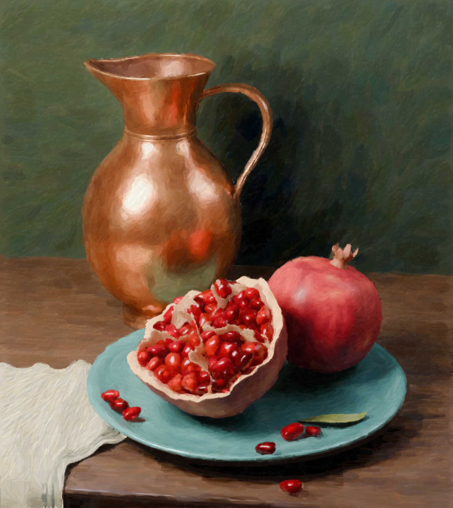

# Quiet Line for Codex

| 石巷留光 | 岬角夜潮 | 石榴与旧铜壶 |
| :---: | :---: | :---: |
| <a href="docs/stone-passage.png"></a> | <a href="docs/night-tide.png"></a> | <a href="docs/ruby-and-copper.png"></a> |

*以上三幅作品均由 Codex 中的 **6.2 Astra Max** 使用 Quiet Line 绘制。*

Quiet Line 给 Codex 一张画布和一套画笔。Codex 规划构图和笔触，Quiet Line 在本机渲染 PNG，并把预览返回到对话。支持墨线、石墨、炭笔、湿油彩，以及可继续编辑的 `.qlproject` 工程。

绘画引擎来自 [Quiet Line 1.4.1](https://github.com/Lomond-PM/quiet-line-board/tree/42f4e9073ed151e2273f67e1f5f32337284aced5)，此仓库提供 Codex 的本地 MCP 接入和绘画技能。

## 安装

需要 Node.js 24 或更新版本、npm，以及支持本地插件的 Codex。先克隆仓库，再在仓库根目录执行：

```sh
git clone https://github.com/Lomond-PM/quiet-line-codex.git
cd quiet-line-codex
npm --prefix ./plugins/quiet-line ci
codex plugin marketplace add .
codex plugin add quiet-line@quiet-line-local
```

新开一个 Codex 本地会话，试试「用 Quiet Line 在暖色纸上画一杯窗边的热茶，保存成可以继续画的工程」。插件在本机运行，工程和 PNG 保存在指定工作目录。

## 工具

- `quiet_line_draw` 从空白画布作画、在已有图片上添画，或继续可编辑工程。
- `quiet_line_project` 查看历史、管理检查点、恢复步骤、另存分支、导出或干化油彩。

两个工具的 `workspace` 参数是本机工作目录的绝对路径。新输出使用工作目录下的相对文件名。显式指定的 PNG 文件名必须是新文件名。默认文件名发生碰撞时自动追加序号。

详见[绘画指南](plugins/quiet-line/engine/DRAWING.md)、[笔触参数](plugins/quiet-line/engine/CONTROL.md)、[干性材料](plugins/quiet-line/engine/DRY-MEDIA.md)和[工程说明](plugins/quiet-line/engine/PROJECTS.md)。

## 本地测试

```sh
npm --prefix ./plugins/quiet-line test
```

也可用附带的命令行入口查看工具参数，或从 JSON 文件调用同一个绘画引擎。

```sh
node ./plugins/quiet-line/cli.mjs --tools
node ./plugins/quiet-line/cli.mjs quiet_line_draw ./args.json
```
