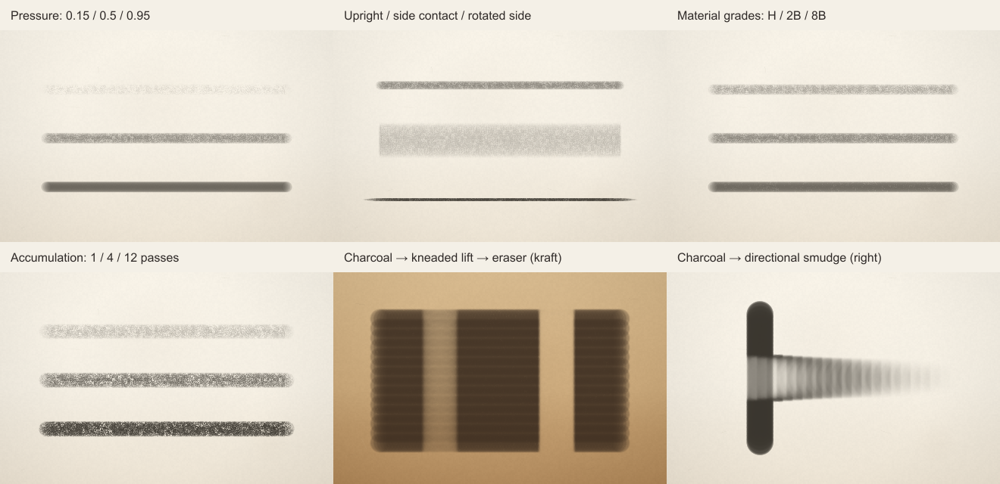

# 1.2.0 — 干性材料 / Dry media

[README](README.md) · [绘画方法 / Drawing practice](DRAWING.md) · [旧笔触与湿画 / Legacy strokes and wet snapshots](CONTROL.md)



复现这张材料对照图：`node examples/dry-study.cjs docs/dry-materials-check.png`。文字标签仅作诊断说明，笔迹来自干性材料引擎。

Reproduce this diagnostic sheet with `node examples/dry-study.cjs docs/dry-materials-check.png`. Labels are annotations outside the unaltered engine renders.

多轮绘画可优先使用[单文件工程](PROJECTS.md)，自动保存材料与历史，不必每轮散落一个 `.qldry`。独立快照继续有效。

For multi-call work, prefer [single-file projects](PROJECTS.md) to retain material and history without scattering `.qldry` files. Standalone snapshots remain supported.

## 两条不同的路径 / Two distinct paths

**中文**

- 不启用 `dry_media` 时，原有 `brush:"pencil"`、`brush:"charcoal"` 与 `strokes` 保持旧的风格化线条流程。它们已有纸纹、毛边、多道笔迹、排线以及逐点宽度／透明度等能力，不自动变成新材料引擎。
- 显式设置 **`dry_media:true`**，通过 **`operations`** 按数组顺序使用铅笔、炭条、普通橡皮、可塑橡皮和纸擦笔。这里保留材料量、附着部分和可移动浮粉，供后续操作使用。
- `operations` 不与 `strokes` 同用；也可以使用 `dry_media:true`、`brush:"pencil"` 或 `"charcoal"` 加 `strokes` 的绘画简写。新流程不与 `subject`、`fills`、`dots`、油画 `paint_state`／`save_state` 或 `wetness`／`impasto`／`load` 混用。需要在一轮内切换画笔、橡皮和纸擦笔时，使用 `operations`。

**English**

- Without `dry_media`, existing `brush:"pencil"` / `brush:"charcoal"` and `strokes` retain their stylized line workflow. It already has paper grain, rough edges, multiple passes, hatching and pointwise width/opacity controls; it does not silently become the material engine.
- Opt in with **`dry_media:true`** and **`operations`**. Array order determines how pencil, charcoal, regular eraser, kneaded eraser and smudge act on the drawing. The simulator retains deposited, bound and movable material for subsequent operations.
- Do not combine `operations` with `strokes`. A drawing-only shorthand accepts `dry_media:true`, `brush:"pencil"` or `"charcoal"` and `strokes`. Neither dry form combines with `subject`, `fills`, `dots`, wet-oil `paint_state` / `save_state`, or `wetness` / `impasto` / `load`. Use `operations` to switch among drawing, erasing and smudging in one call.

提供 `operations`、`dry_state` 或 `save_dry_state` 也会启用新模式；建议在示例和计划中明确写出 `dry_media:true`。`dry_media:false` 不能与这些字段同时使用。

Supplying `operations`, `dry_state` or `save_dry_state` also enables the new mode; examples spell out `dry_media:true` for clarity. `dry_media:false` conflicts with those fields.

## 工具与材料 / Tools and materials

| `tool` | 中文 | English |
| --- | --- | --- |
| `pencil` | 石墨式沉积；压力、软硬等级与纸齿共同影响加深 | Graphite-like deposition; pressure, grade and tooth affect tone |
| `charcoal` | 炭粉式沉积，可供擦揉的松散材料较明显 | Charcoal-like deposition, with a stronger loose-powder character |
| `eraser` | 移除已有的新材料，适合明确修正 | Removes modeled material for firmer corrections |
| `kneaded` | 渐进式吸起，适合提亮与找形 | Gradual lifting for highlights and shape recovery |
| `smudge` | 沿路径移动部分浮粉，不产生新石墨或炭粉 | Moves some loose material along the path without creating pigment |

普通橡皮与可塑橡皮不是涂白；它们使下方的原始纸底重新显露。纸擦笔不是全图高斯模糊，不应把所有结构边都揉掉。`pressure:0` 表示不接触，不能用它代替“轻轻擦揉”；轻操作应使用小的正压力。

Erasers reveal the preserved substrate rather than painting white. Smudge is not a whole-image Gaussian blur; use it selectively instead of dissolving every structural edge. `pressure:0` means no contact, not a gentle smudge; use a small positive pressure for light work.

## 操作字段 / Operation fields

`points` 使用归一化画布坐标，通常在 `0..1`。字段作用于当前操作，不要把操作级 `pressure` 与旧接口全局自动压力变化参数混淆。优先显式提供关键参数，尤其是工具、材料等级、宽度、压力和侧锋角度。

`points` uses normalized canvas coordinates, normally `0..1`. Fields belong to the operation; its `pressure` is not the legacy global automatic pressure-variation setting. Specify important choices explicitly, especially tool, grade, width, pressure and tip orientation.

| 字段 / Field | 值 / Values | 用法 / Meaning |
| --- | --- | --- |
| `tool` | `pencil`, `charcoal`, `eraser`, `kneaded`, `smudge` | 当前操作 / Current action |
| `points` | `[[x,y], ...]` | 至少 2 点；坐标 `-0.2..1.2` / At least 2 points; coordinates `-0.2..1.2` |
| `color` | `ink`, `accent`, `clay`, `ochre`, `sage`, `#rrggbb` | 新沉积材料颜色，默认 `ink`；橡皮和擦揉不凭此加色 / Deposited pigment colour, default `ink`; erasers and smudge do not add it |
| `width` | `0.1..30` | 相对基础 `weight` 的倍率，不是像素直径 / Multiplier of base `weight`, not pixel diameter |
| `pressure` | `0..1` | 接触与材料作用强度；0 抬笔 / Contact and action strength; 0 lifts the tool |
| `opacity`, `flow` | `0..1` | 操作强度／沉积控制；不是新建图层的整体透明度 / Action/deposition controls, not the opacity of an editable layer |
| `grade` | `H`, `HB`, `2B`, `4B`, `6B`, `8B` | 沉积材料的软硬预设，不是完整真实品牌标定 / Material-grade presets, not calibrated real-world brands |
| `tip` | `round`, `flat` | 接触形状选择 / Contact-footprint selection |
| `angle` | `-360..360` | 画布内定向角，0 向右 / Canvas orientation in degrees; 0 points right |
| `tilt` | `0..1` | 倾斜铺开程度 / Degree of side contact |
| `aspect` | `0.05..1` | 定向笔尖的短长轴比例 / Minor-to-major footprint ratio |
| `cap` | `round`, `flat`, `taper` | 端头处理 / Endpoint treatment |
| `closed` | boolean | 是否闭合路径 / Close the path |
| `controls` | 与 `points` 等长的对象数组 / One object per point | 局部 `pressure`、`width`、`opacity`、`angle`、`tilt` / Local control of those fields |

操作默认值 / Operation defaults: `pressure:0.5`, `opacity:0.95`, `flow:1`, `width:1`, `grade:"2B"`, `angle:0`, `tilt:0`, `tip:"round"`, `aspect:0.3`, `cap:"round"`。

`controls.pressure` 覆盖当前操作的压力；`controls.width`（`0..3`）和 `controls.opacity`（`0..1`）为局部倍率。`controls.angle` 沿最短转角插值，`controls.tilt` 控制侧锋程度。倾斜会展开定向接触面，`tip:"flat"` 还使用 `aspect`；这不是三维笔杆力学。操作级 `pressure` 控制材料接触，顶层 `pressure` 控制轻微的自动沉积变化，并不是它的替代品；设顶层 `pressure:0` 可关闭此变化，`wobble:0` 可关闭几何起伏。

`controls.pressure` overrides the operation pressure; `controls.width` (`0..3`) and `controls.opacity` (`0..1`) are local multipliers. `controls.angle` interpolates by the shortest rotation and `controls.tilt` varies side contact. Tilt spreads an oriented footprint; `tip:"flat"` also uses `aspect`. This is not 3D stylus mechanics. Operation pressure controls material contact; top-level `pressure` controls mild automatic deposition variation, not contact pressure. Set top-level `pressure:0` to disable that variation and `wobble:0` to disable geometric wandering.

材料等级从 H 到 8B 逐渐变软，影响沉积及浮粉。它不是油画 `hardness`；后者指边缘沉积软硬，不是 HB/2B 这种铅芯材料等级。

Grades progress from harder H to softer 8B, affecting deposition and loose powder. Material grade is not oil `hardness`: the latter controls an oil footprint's edge deposition, not graphite hardness.

### 简写 / Shorthand

```json
{
  "dry_media": true,
  "brush": "pencil",
  "size": 640,
  "strokes": [
    {"points": [[0.2,0.5],[0.8,0.5]], "width": 8, "pressure": 0.35, "grade": "4B", "tilt": 0.7}
  ]
}
```

仅此 opt-in 简写中，stroke 的 `width` 可到 30，并接受操作级 `pressure` 和 `grade`；未启用 `dry_media` 的旧 `strokes` 参数范围和语义保持原样。需要橡皮／擦揉，请改用 `operations`。

Only this opt-in shorthand extends stroke `width` to 30 and accepts operation `pressure` and `grade`. Without `dry_media`, legacy stroke ranges and semantics remain unchanged. Use `operations` for erasing or smudging.

## 例一：按顺序落笔、擦揉、提亮 / Example 1: draw, smudge, lift

以下是小型参数练习，不是完成的写实素描。先铺石墨，再加炭条，用纸擦笔带开一处暗部，最后提亮。操作会依次执行，因此橡皮只影响它执行之前已经存在的材料。

This is a small parameter study, not a finished realistic drawing. It lays graphite, adds charcoal, moves some shadow material and then lifts a highlight. Operations execute in order: an eraser affects only material already present when it runs.

```json
{
  "dry_media": true,
  "title": "Graphite and charcoal study",
  "surface": "warm",
  "size": 640,
  "seed": 623,
  "weight": 3,
  "wobble": 0,
  "save_dry_state": "quiet-line-out/dry-study-1.qldry",
  "operations": [
    {
      "tool": "pencil", "grade": "2B",
      "points": [[0.18,0.45],[0.5,0.4],[0.8,0.5]],
      "width": 9, "pressure": 0.3, "opacity": 0.8,
      "tip": "flat", "angle": 25, "tilt": 0.8, "aspect": 0.3
    },
    {
      "tool": "charcoal", "grade": "6B",
      "points": [[0.22,0.53],[0.52,0.54],[0.78,0.58]],
      "width": 7, "pressure": 0.6, "opacity": 0.8
    },
    {
      "tool": "smudge",
      "points": [[0.35,0.54],[0.4,0.58],[0.48,0.62]],
      "width": 9, "pressure": 0.35
    },
    {
      "tool": "kneaded",
      "points": [[0.35,0.43],[0.45,0.43]],
      "width": 3, "pressure": 0.45
    }
  ]
}
```

## 例二：从材料状态继续 / Example 2: continue from material state

```json
{
  "dry_media": true,
  "dry_state": "quiet-line-out/dry-study-1.qldry",
  "save_dry_state": "quiet-line-out/dry-study-2.qldry",
  "operations": [
    {
      "tool": "pencil", "grade": "HB",
      "points": [[0.24,0.4],[0.48,0.35],[0.73,0.43]],
      "width": 0.8, "pressure": 0.5,
      "controls": [
        {"pressure": 0.1},
        {"pressure": 0.65},
        {"pressure": 0.1}
      ]
    },
    {
      "tool": "eraser",
      "points": [[0.64,0.48],[0.7,0.49]],
      "width": 2, "pressure": 0.6
    }
  ]
}
```

恢复时省略画布尺寸、纸面、种子和纸纹等固定属性，让状态继承。后续笔触的 `weight`、`wobble`、顶层 `pressure`、`accent` 以及默认 `brush` 可以调整；这不重建已经保存的纸齿，也不追溯修改已有笔画。不要同时提供 `dry_state` 与 `base_image`，也不要通过更改参数缩放一个已有状态。修改构图或试另一种处理时，可以从旧状态另存新分支。

When restoring, omit fixed canvas, surface, seed and grain choices so the snapshot supplies them. You may adjust `weight`, `wobble`, top-level `pressure`, `accent` and default `brush` for subsequent marks; this neither rebuilds the saved tooth nor changes earlier marks retroactively. Do not combine `dry_state` with `base_image`, or resize an existing state by changing canvas parameters. Start a new branch from an earlier state when trying another treatment.

## PNG、底图、干画与湿画状态 / PNG, base images, dry and wet state

| 类型 / Type | 保留什么 / What it retains | 不能做什么 / What it cannot recover |
| --- | --- | --- |
| PNG/JPEG/WebP `base_image` | 展平像素，作为受保护底图 / Flattened pixels as protected substrate | 不能从黑色像素反推旧炭粉或擦掉原图笔迹 / Cannot infer or erase the old charcoal represented by pixels |
| `.qldry` `dry_state` | 干性材料模拟与底图，用于新干画操作 / Dry-material simulation and substrate for further operations | 不能当作湿油画状态 / Not a wet-oil snapshot |
| `.qlpaint` `paint_state` | 油画／画刀的湿画状态 / Wet oil / palette-knife state | 不能当作干画材料状态 / Not dry-material state |

**底图边界：** 在 `base_image` 上新增石墨或炭粉后，可以擦除、提亮、搬运这些**新材料**；不能用橡皮或纸擦笔改动底图里已经压平的老笔迹。即使旧图恰好也是这个插件画的，PNG 也没有保留材料分解。擦完只会回到原来底图，而不是自动回到白纸。透明底的原始 alpha 也属于底图，不应被擦成白色。

**Base-image boundary:** You can erase, lift and move **new material** added above a `base_image`, but not the old flattened strokes inside it. Even a PNG made by this plugin has lost that material decomposition. Erasing reveals the original image, not an imagined blank sheet. Original substrate alpha belongs to that image too; erasing must not turn it into white paint.

## 保存与安全 / Saving and safety

- `.qldry` 独立于 `.qlpaint`，使用带版本和校验的有界状态数据，不反序列化可执行代码。不要靠改扩展名互转。
- `save_dry_state` 显式请求状态保存；未请求时不要假设 PNG 旁总有可恢复状态。
- 状态输出在工作目录内，父目录必须已经存在，并以新文件保存，不覆盖旧文件；为每个检查点使用不同文件名。拒绝 `../` 与符号链接／junction 导致的目录逃逸。保留旧节点便于回退与分支，这不是任意单笔撤销或可编辑图层。
- 每轴最多 2560 像素；每次最多 600 个操作，每条路径最多 400 点，总点数最多 40,000。状态数组最多 100 MiB，压缩与解压数据上限 104 MiB，头部最多 16 KiB。它不是可无限增长的历史日志。
- 保存／加载、PNG 编码仍有画布大小相关成本。局部操作不会让整张图的输出变成常数时间；避免无目的反复导出。

- `.qldry` is separate from `.qlpaint`: versioned, validated, bounded state data, not executable deserialization. Renaming the extension does not convert a format.
- Request `save_dry_state` explicitly; a PNG does not imply that a restorable material state was saved beside it.
- State outputs stay within the working directory, require existing parent directories and create new files without overwriting. Give checkpoints distinct names. Escapes through parent traversal or symlinks/junctions are rejected. Retaining checkpoints enables call-level rollback and branches, not arbitrary stroke undo or editable layers.
- Each axis is at most 2560 pixels. A call accepts at most 600 operations, 400 points per path and 40,000 points in total. State arrays total at most 100 MiB. Compressed and decompressed data are bounded at 104 MiB, with a 16 KiB header limit. This is not an indefinitely growing history log.
- State I/O and PNG encoding still have canvas-sized costs. Local painting does not make complete exports constant-time; avoid purposeless repeated exports.

## 练习顺序与局限 / Practice order and limitations

1. **压力阶梯：** 同一根线、同一宽度，逐步增加压力，比较密实度，而不只是线宽。
2. **侧锋对照：** 固定路径，比较立笔与侧锋的覆盖方向和宽窄。
3. **叠灰与提亮：** 在小区域里先轻叠两轮，再用可塑橡皮渐提，用普通橡皮修一条更明确的边。
4. **方向擦揉：** 把一段炭痕向一个方向带开，检查另一侧和无材料区不应凭空生黑。
5. **小幅静物：** 按大形、三明度、结构排线、局部擦揉、提亮的顺序画，再查看输出决定下一轮。

1. **Pressure ladder:** Repeat a path at one width and increasing pressures; compare density, not just thickness.
2. **Side-contact comparison:** Hold the path fixed and compare upright versus tilted contact and direction.
3. **Layer and lift:** Build two light passes in a small area, gradually lift with kneaded eraser, then use regular eraser for a firmer edge.
4. **Directional smudge:** Move a charcoal mark in one direction. The other side and empty areas should not gain pigment from nowhere.
5. **Small still life:** Block shape, three values, structural hatching, selective smudge and lifted lights; inspect the result before deciding the next pass.

**颜色与材料量并非独立颗粒层：** 每个像素分别保存附着量与松散量，但两者共用一个颜料 RGB。纸擦笔搬运松散材料、保持附着量不移动；这里的守恒针对总材料量，颜色使用局部平均混合近似，不能理解为不同颜色颗粒或独立分层颜色的严格质量守恒。叠画有色材料后擦揉，不等于真实地单独搬走最上面一种颜色。

**Colour and amount are not independent particle layers:** Each pixel stores bound and loose amounts separately but shares one pigment RGB. Smudge moves loose material while leaving the bound amount in place. Conservation concerns total material amount; colour uses local averaged mixing, not strict conservation of separate coloured particles or layered colour components. Smudging mixed coloured marks does not physically pick up only the uppermost colour.

材料等级、压力、附着与擦揉都是艺术用途的程序近似，不包含真实颗粒碰撞、石墨反光、纸张磨破或真实品牌硬度测量。新干性材料操作不提供自动构图、自动三维光照、自动曲面排线或完整编辑器功能；这些仍需要模型规划。更完整的方法见 [绘画指南](DRAWING.md)。

Grades, pressure, adhesion and smudge are artistic procedural approximations, not real particle collisions, graphite sheen, paper damage or calibrated brand hardness. The workflow does not automatically compose a picture, solve 3D lighting, generate surface-following hatching or supply a complete editor; the model still plans those decisions. See [Drawing with intention](DRAWING.md) for the fuller practice guide.
