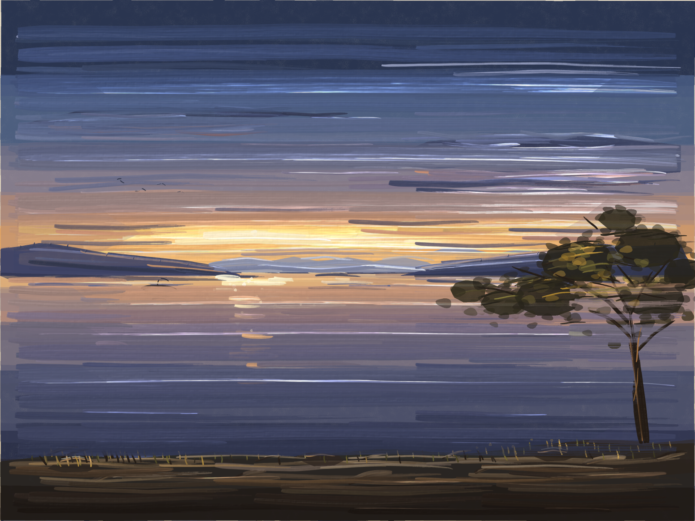
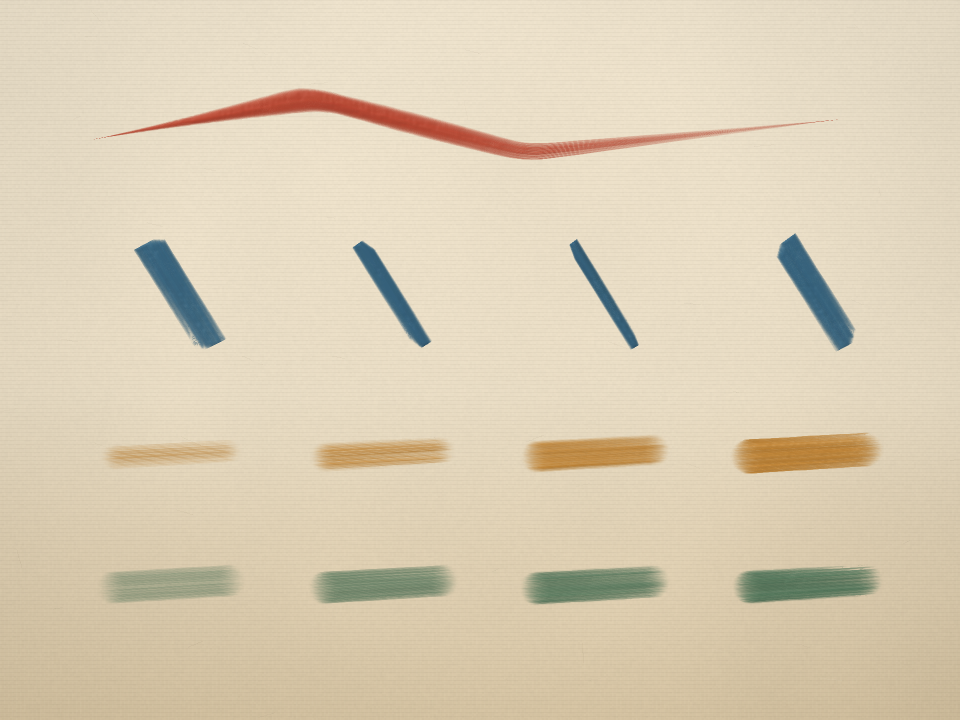

# Quiet Line

### 让你的 DSH 可以画画。
### Give your DSH a paintbrush.



*封面由 **Mimo 2.6 Flash** 使用本插件绘制，由用户提供。*

*Cover artwork drawn by **Mimo 2.6 Flash** using this plugin, shared by the user.*

[中文](#不只是回答也能画给你看) · [English](#let-your-ai-draw-something-for-you) · [下载安装 / Download](https://github.com/Lomond-PM/quiet-line-board/releases/latest) · [进阶用法 / Brush controls](CONTROL.md)

---

## 不只是回答，也能画给你看

有时候，一张画比一段描述更合适。

Quiet Line 是给 DSH 里的 AI 用的画板，主要模拟真实绘画材料的落笔表现。你说想画什么，AI 来安排构图、选择颜色，再用这些画具一笔一笔画出来。

可以是一片傍晚的湖，一只系着围巾的小猫，也可以只是桌上那杯还冒着热气的茶。不需要你先写坐标，也不用另外接入生图服务。

**它不是把提示词转交给另一个生图模型。** AI 在这里负责构思和调用画笔，插件负责把线条、色块和颜料变成真正的图片。因此，换一个模型、换一种画法，也可能得到很不一样的作品。

## 装好之后，试着这样说

> 帮我画一幅日落时的湖景。天空是深蓝和灰紫色，远处留一条暖黄色的光，右边有一棵树。用油画笔，笔触可以松一点。

> 画一只系着红围巾的小猫，用铅笔画在暖色纸上，不用太工整。

> 用 Quiet Line 画一杯热茶，放在窗边，像随手画下来的生活小景。

画完后，也可以接着聊：

> 保留现在这张画，在湖面上添几道晚霞的倒影，别动天空。

它提供了继续在原图上添画的能力；如果希望下一次还能拾取和混合未干的油彩，可以让 AI **保存在一个绘画工程中**，下次从这个工程继续。就像把画留在画架上，而不是只拍一张照片。

> 小提示：作品效果与所用模型、构图安排和笔触规划有关。它是一套可以自由使用的画具，不是保证每次都画出相同效果的滤镜。

## 几支画笔，几种不同的心情

- **钢笔与墨线**：用清晰的线缘和变化的笔压画轮廓或速写。
- **铅笔与炭笔**：按压时，石墨与炭粉随纸齿留下颗粒，可以用橡皮提亮，也可以擦揉散开。
- **毛刷与马克笔**：毛刷留下刷丝纹，半透明的马克笔可以叠色。
- **油画笔与画刀**：从湿颜料中拾色，在交叠处混色，并留下刷痕和厚度。可以先让油彩干化，再继续添画。

可以换上暖白纸、冷压纸、牛皮纸、亚麻布、新闻纸或深色画纸。同一个题材，换一套画具，感觉也会不同。

想控制得更细，也能告诉它哪里按重一点、哪里提笔，如何转动油画扁平刷，以及颜料要湿一些还是干一些。一般使用不需要记住这些参数；需要时再看[笔触与湿画指南](CONTROL.md)。

## 显式干化油彩

有油彩的工程可以显式“干化当前油彩”。干化立即生效并新增一个工程步骤，保留画面、颜色和厚度。之后添画时，已干油彩不会参与湿拾色。如需长期保留干化前的湿状态，可设置命名检查点或另存分支。详见[工程指南](PROJECTS.md)。

## 在一幅画里交替用笔

空白工程里可以按画面需要换笔。例如可以用炭笔起型，再用油画笔、调色刀或马克笔添画。各材料的状态随工程保存，返回炭笔时仍可擦揉已有炭粉，返回油彩时已有湿颜料仍可拾色。详见[工程指南](PROJECTS.md)。

所有画笔的整体笔宽倍率放宽为 **0.1..30**，逐点局部倍率仍为 **0..3**，不是像素值。绘画指南介绍构图、透视、光照和明暗组织，也包括可选的参考图与三辅二方法。薄涂用低不透明度、低负载颜料作视觉近似。详见[绘画方法](DRAWING.md)与[笔触说明](CONTROL.md)。

## 一幅画，一个工程

1.3.0 新增 **`.qlproject` 单文件工程**。后续只需继续使用同一个工程，材料和过程状态自动保存，不必每一步新建 `.qlpaint` 或 `.qldry`。默认保留最近 **30 步自动历史**，另支持最多 **64 个命名检查点**，可查询、回退、另存分支和导出。

> 把这幅画保存在一个 Quiet Line 工程里。关键阶段命名留档，之后都继续这个工程，不用每轮单独保存湿画快照。

默认逻辑容量为 **2 GiB**；达到限制时先清理旧的未命名历史，不动当前步骤或命名检查点。单文件不等于无限空间：历史仍使用压缩后的完整材料快照。支持把旧快照导入新工程，原文件不变。详见[单文件工程指南](PROJECTS.md)。

## 新增：不只是像素描，也能按素描的方法画

1.2.0 新增独立的 **干性材料模式**：石墨与炭粉可以逐次沉积，用侧锋铺大灰面，再用普通橡皮、可塑橡皮提亮，或用纸擦笔沿形带开浮粉。同一次调用中可以按顺序换工具；保存 `.qldry` 状态后，下次继续擦、揉和添画。

> 用新的干性材料模式画一只梨。先定左上光，用铅笔侧锋铺三组明暗，再用炭条压实接触暗部，用可塑橡皮提出一处高光。看一下结果，按画面需要修正比例和边缘。

这是显式开启的 `dry_media:true` 新路径，原有铅笔／炭条风格化笔触保持不变。已有图片是受保护的底图：只能擦揉这次新加的材料，不能反向恢复或擦除原图中已经展平的老笔迹。详见[干性材料指南](DRY-MEDIA.md)。

笔触尺度、密度和修改方式由画面目标决定。可以按创作意图参考[绘画指南](DRAWING.md)中的方法和练习。

## 安装到 DSH

1. 到 [Releases](https://github.com/Lomond-PM/quiet-line-board/releases/latest) 下载 `.tgz` 安装包。
2. 在 DSH 的插件管理器中添加这个安装包，并启用 Quiet Line。
3. 回到对话，告诉 AI：“用 Quiet Line 帮我画一幅……”

安装后，AI 会获得 `quiet_line_draw` 绘画工具和 `quiet_line_project` 工程管理工具。升级后若仍看不到新参数，请重启 DSH，让缓存的插件代码重新加载。

图片默认保存在当前工作目录的 `quiet-line-out/` 中；能否直接在对话中显示预览，取决于当前 DSH 的图片附件服务与大小限制。绘画引擎本身不调用外部生图 API；与你使用的 AI 模型对话仍可能产生模型费用。

## 也说清楚它的边界

Quiet Line 是给 AI 使用的轻量画具，不是 Photoshop，也不是完整的绘画编辑器。

- 可以在已有图片上继续添画，但普通图片只有已经落定的像素，不能自动还原成湿颜料或可编辑图层。
- 油画可以保存 `.qlpaint` 湿画快照，新干性材料模式可以保存独立的 `.qldry` 状态，方便从某一次调用的节点继续、回退或分支；两种格式不能互换，目前没有独立图层、蒙版或任意单笔撤销。
- 笔触、纸齿和厚涂都是程序模拟，不是对真实颜料的完整物理复现。

---

## Explicit oil drying

In a project containing oils, the dry_paint action dries the current oil immediately and records a new step. It preserves the artwork, colour and relief, and subsequent strokes skip wet pickup from the dried paint. Pin a checkpoint or branch to keep a recoverable wet state. See [projects](PROJECTS.md).

## Let your AI draw something for you

Sometimes a picture is a better answer.

Quiet Line is a drawing board for DSH that simulates the behaviour of traditional art materials. Tell the AI what you have in mind and it can plan the composition, choose its colours and draw it stroke by stroke.

A lake at dusk. A cat in a red scarf. A cup of tea by the window. You don't need to write coordinates or connect a separate image-generation service.

**This isn't a wrapper around another image model.** The AI plans and uses the drawing tools; the plugin turns its strokes, washes and paint into an image. Different models and different approaches can leave very different marks.

### Try asking

> Use Quiet Line to paint a lake at sunset. Deep blue and muted purple clouds, a narrow band of warm light on the horizon, and a tree on the right. Keep the oil brushwork loose.

> Draw a small cat wearing a red scarf, in pencil on warm paper. A little imperfect is fine.

And once it's finished:

> Keep this painting, but add a few sunset reflections on the water. Leave the sky alone.

For wet oil pickup and mixing across calls, ask the AI to **save one drawing project** and continue it later. Think of leaving a painting on the easel rather than only keeping a photograph.

### Pick a different feel

Ink and fountain pens respond to pressure with distinct line edges. Bristle brushes leave streaks and translucent marker marks can build up with each pass. Graphite and charcoal settle into the paper tooth and can be erased or smudged. Oil brushes and palette knives pick up wet pigment, build raised paint and support drying before the next pass. Six surfaces range from warm drawing paper to woven linen and dark charcoal paper.

For more deliberate marks, the tool offers per-point pressure, width and opacity; wet oils also simulate rotated and tilted flat tips, edge hardness and flow. You don't need to learn the parameters to get started. See the [controls guide](CONTROL.md) for legacy strokes and wet oils, including JSON examples and implementation limits.

### Use different tools on one canvas

A blank project accepts brushes in any order. For example, a drawing could combine charcoal construction, oil passages, and ink or marker. The project keeps each material state across brush changes. When you return to charcoal, earlier dry pigment can still be smudged. When you return to oil, the earlier wet oil remains available for pickup. See the [project guide](PROJECTS.md).

Overall stroke width now accepts **0.1..30** for all brushes; per-point width stays **0..3**. These are multipliers, not pixels. The drawing guide covers approaches to composition, perspective, light and value structure, along with optional references and 3D-to-2D aids. Low-opacity, low-load paint visually approximates thin washes, not solvent chemistry. See [drawing practice](DRAWING.md) and [controls](CONTROL.md).

### One painting, one project

Version 1.3.0 adds **single-file `.qlproject` projects**. Reuse one project path; material state and history save automatically without scattering `.qlpaint` / `.qldry` files. Defaults retain **30 automatic steps** plus up to **64 named checkpoints**, with history listing, restore, branches and exports.

> Keep this painting in one Quiet Line project. Name important stages, and continue the same project rather than saving a separate wet snapshot after every pass.

Logical capacity defaults to **2 GiB**. Old unpinned history is pruned first, never the current head or named checkpoints. One file is not unlimited storage: steps hold full compressed material snapshots. Import existing snapshots into new projects without changing the sources. See the [single-file project guide](PROJECTS.md).

### New: draw with dry materials, not just a sketch-like texture

Version 1.2.0 adds an opt-in **dry-media workflow**: layer graphite or charcoal, shade with side contact, lift highlights with regular or kneaded erasers, and move loose powder with a directional smudge tool. Switch tools in order within one call, then save a `.qldry` snapshot for further drawing, lifting and blending later.

> Use the new dry-media mode to draw a pear with upper-left light. Block three values with pencil side strokes, deepen the contact shadow in charcoal, and lift one highlight with a kneaded eraser. Inspect the result and revise the proportions and edges as the drawing needs.

Enable it explicitly with `dry_media:true`; existing stylized pencil/charcoal strokes stay unchanged. An existing image remains protected substrate: you can erase or smudge newly deposited material, not recover or remove the old flattened strokes inside the image. See the [dry-media guide](DRY-MEDIA.md).

The artwork's intent guides stroke scale, density and revisions. The bilingual [drawing guide](DRAWING.md) offers optional methods and exercises.

### Install

1. Download the `.tgz` package from [Releases](https://github.com/Lomond-PM/quiet-line-board/releases/latest).
2. Add it through DSH's plugin manager and enable Quiet Line.
3. Ask your AI to draw with Quiet Line.

The plugin registers `quiet_line_draw` and the `quiet_line_project` history manager. Restart DSH after an upgrade if the active tool parameters are still cached. Images are saved under `quiet-line-out/` in the working directory; inline previews depend on DSH's attachment service and limits.

The renderer does not call an external image-generation API. Normal usage of your chosen AI model may still incur model costs. Results depend on the model's composition and stroke planning, not just the brush settings.

### A drawing toolkit, not a full editor

Existing images support overpainting, not automatic recovery of their original materials or layers. Wet oil `.qlpaint` and dry-media `.qldry` snapshots allow call-level continuation, rollback and branches; the two formats are not interchangeable. There are no editable layers, masks or arbitrary per-stroke undo. Paint and paper behaviour are procedural approximations, not a complete physical simulation.

---

## 给想折腾画笔的人 / For the brush tinkerers



上至下：压力与转笔、固定角度扁平刷、由软到硬的边缘、由低到高的流量。

Top to bottom: pressure with rotation, fixed-angle flat tips, soft-to-hard edges, and increasing flow.

- [单文件工程、历史与检查点 / Projects, history and checkpoints](PROJECTS.md)
- [绘画方法与练习 / Drawing methods and exercises](DRAWING.md)
- [干性材料、橡皮与纸擦笔 / Dry media, erasers and smudge](DRY-MEDIA.md)
- [笔触控制与湿画快照 / Controls and wet snapshots](CONTROL.md)
- [在已有图片上添画 / Dry image continuation](CONTINUATION.md)
- [画笔、材质与引擎参考 / Brushes, surfaces and engine reference](docs/REFERENCE.md)
- [厚涂说明 / Paint-volume notes](VOLUME.md)
- [更新记录 / Changelog](CHANGELOG.md)

开发环境 / Development: Node.js 24+.

```sh
npm install
npm test
node examples/control-study.cjs
```

测试覆盖逐点参数、扁平刷接触形状、状态文件校验，以及一次完成与分步湿画输出一致性。未启用新字段的八种旧画笔回归样例已与 1.0.19 比较，PNG 字节一致。

Tests cover point controls, flat-tip footprints, state-file validation, and matching single-call/split-call wet painting. Legacy regression samples across all eight brushes match 1.0.19 PNG bytes when new fields are absent.
