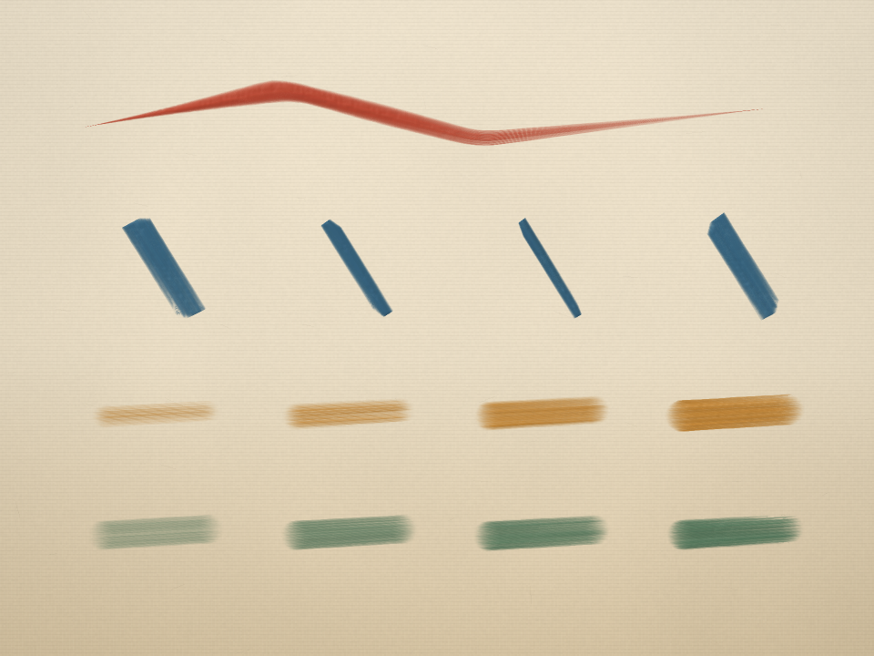

# Engine reference and historical notes

> This reference preserves the previous technical README. Historical local evidence and snapshots mentioned below are not included in this repository. For the current introduction and installation instructions, see [the homepage](../README.md).

# Quiet Line board

A DSH Host plugin that gives the agent a small hand-drawn illustration board.

It registers one tool, **`quiet_line_draw`**. A call draws with a chosen brush on a chosen material, using natural ink weight, wobble, tapered lifts, translucent washes, hatching and paper grain; it then writes a PNG under the session's `quiet-line-out/` folder and attaches the image to the tool result.



上至下 / Top to bottom: pressure + rotating flat tip; fixed-angle flat tips; hardness 0→1; flow 0.25→1. Reproduce with `node examples/control-study.cjs`.

## 中文说明 · 1.1.0

Quiet Line 是可供 DSH Agent 调用的程序手绘引擎，注册 `quiet_line_draw` 工具，支持八种画笔、六种纸布材质、自定义线条、色块与点，以及油画颜料拾取、混色、纸齿和厚涂。

本版新增：
- 逐点 `controls`：压力、宽度、透明度、旋转角度与倾角。
- 油画旋转扁平刷、可独立调整的软硬边 `hardness` 与流量 `flow`、端头形状。
- `save_state` / `paint_state`：跨调用保留湿料与厚度，保存节点可用于回退或分支。
- 保留旧参数与旧画法；不提供完整图层、蒙版或任意单笔撤销。

在 DSH 插件管理器选择“添加插件”，安装本仓库目录，或安装发布的 tgz 包。开发测试需要 Node.js 24+ 和依赖 `sharp`：先运行 `npm install`，再运行 `node tests/controls.cjs`、`node tests/state.cjs`、`node tests/integration.mjs`。绘画示例与完整参数说明见 [CONTROL.md](../CONTROL.md)。

## English · 1.1.0

New precision controls provide per-point pressure, width, opacity, angle and tilt; a rotatable flat oil brush; independent hardness and flow; and configurable caps. `save_state` writes a new wet-paint snapshot, and `paint_state` restores pigment, coverage, height and drying state across calls. Keep snapshots for call-level rollback or branches. This is not an editable-layer, mask or arbitrary per-stroke undo system.

Install the repository directory or release tgz via DSH **Plugins → Add plugin**. For development, use Node.js 24+, run `npm install`, then `node tests/controls.cjs`, `node tests/state.cjs`, and `node tests/integration.mjs`. See [CONTROL.md](../CONTROL.md) for parameters, continuation examples and limitations. No-new-field rendering is regression-tested against 1.0.19 across all eight brushes. The engine does not call an image-generation API or use the network when drawing.

## 1.0.19 — continue painting over an existing image

Pass `base_image` (a local PNG, JPEG or static WebP path) and draw only the new
marks. Dimensions default to the oriented original, reduced proportionally only
above 2560px. Old pixels do not receive a new paper/grain layer. PNG alpha is
preserved. Continuations always save a NEW file: an occupied explicit output is
rejected, and default names gain numeric suffixes. No built-in study is added
implicitly when a base image is supplied. See `CONTINUATION.md` for examples,
limits and iteration guidance. Fresh-canvas output remains byte-identical to 1.0.18.

A base image supplies flattened pixels for overpainting. A .qlproject or
material snapshot preserves the wet pigment or dry material needed for
material-aware continuation. Choose the approach that fits the requested edit.

## 1.0.18 — coherent paint-volume lighting

Resolves the intact height field before clearing it, fixing a scan-order defect
that zeroed the left/up neighbours during shading. Smooths height for lighting
only and uses bounded diffuse light, a restrained broad reflection and shallow
groove occlusion. Impasto now gives coherent lit and shaded ridge shoulders.
The actual film height, coverage, pigment mixing and hair geometry are unchanged.
Fine strokes retain their footprint, but their lighting is intentionally changed;
this release does not claim byte-identical fine/knife PNGs. No external drop
shadow or added outline. See `VOLUME.md` for invariants and limitations.
The accepted 1.0.17 package and its snapshot remain untouched for rollback.

## 1.0.17 — conservative bristle width refinement (baseline history)

Builds on the verified 1.0.16 recovery. Slightly differentiates interior hair
widths on broad oil marks, keeping their expected mean width unchanged, and
softens along-hair width oscillation. The effect fades toward the outer hairs
and is disabled for marks up to 8 canvas pixels wide and for the palette knife.
No random calls, hair start/end indices, pigment shade or mixing formulas change.
The fine-mark and knife regression PNGs remain byte-identical to 1.0.16.
See `REFINEMENT.md`. The unchanged 1.0.16 package remains the rollback baseline.

## 1.0.16 — restored 1.0.9 rendering (baseline history)

Restored from recorded historical edits, not guessed image parameters. Five saved
1.0.9 outputs (short-stroke board, cup, cat, long stroke, crossing close-up) have
identical PNG SHA-256 hashes when rendered with the recovered implementation.
The source retains some disabled experimental branches from the reconstruction;
this is verified rendering recovery, not a claim of original source byte identity.
Version 1.0.15 and its snapshot are retained separately for rollback.
See `RECOVERY.md` for the exact changes and verification evidence.

## Brushes

| brush | character |
| --- | --- |
| `ink` | solid, confident ink pen |
| `fountain` | fine, crisp, high-contrast fountain pen |
| `pencil` | lighter graphite with two granular passes |
| `charcoal` | broad, dry, smudged multi-pass charcoal |
| `brush` | dense brush body with visible bristle streaks |
| `marker` | wide, flat-ended, translucent marker |
| `oil` | loaded, opaque oil brush with tinted impasto ridges |
| `oilknife` | flat palette-knife stroke with a hard edge and bright ridge |

## Oil simulation

`oil` and `oilknife` do not use the alpha-blended ribbon path. They paint into a
per-pixel paint film (`lib/oil.cjs`) that stores pigment colour, film coverage,
paint thickness and the stroke that laid it down.

- **Bristle contact, not a filled band.** A stroke is a stand of hairs walking
  the smoothed centreline. Each hair lays its own line, and the mark is the union
  of what those hairs actually touched — with the hair's own width, not the
  brush's.
- **Value between the lines.** The subtle differences in a real brush mark live
  between the individual hair lines, not inside one line: every hair carries its
  own value, and the paint itself is even within a line.
- **No even-width line.** A hair loads and unloads along its length, so its line
  widens and narrows as it goes; the stroke's outline therefore never breathes in
  and out as one shape.
- **Square landing.** A flat brush lands square and fully loaded: the mark starts
  at full width. Each hair falls short of the ends by its own distance (pixels,
  not percent), so the mark ends rounded and frayed instead of cut square.
- **Paint load and the breaking edge.** A loaded brush carries paint past the end
  of the gesture: the body stays solid and only the last stretch frays. A low
  `load` runs dry part way through and starts to skip over the canvas. The outer
  hairs carry less paint and give out first.
- **Coverage, not transparency.** Coverage saturates to an opaque film and later
  pigment changes the *colour* of that film. Two crossing strokes read as paint
  over paint, never as two translucent bands stacked up.
- **Transport at the rim only.** A hair samples paint that was already on the
  board (never its own fresh trail, which would feed colour back into itself),
  picks some of it up smoothly and carries it a distance before it fades back to
  the loaded pigment. On a loaded, non-wet crossing the new stroke covers the old
  one and only its rim drags the colour underneath; `wetness` widens that mixing.
- **Canvas tooth.** Adhesion is gated by a per-surface tooth map (paper grain,
  cold-press plateaus, linen weave, kraft fibre, newsprint screen), so the
  material affects where paint sticks instead of sitting behind it as a texture.
- **Resolving.** `flushOil()` composites the film into the shared premultiplied
  ink buffer: thickness becomes relief light and groove shadow, ridge tops catch
  a broken glint, and the film's edge leaves a loaded bead. The film is resolved
  wherever a wash or charge interrupts the drawing order, so oil keeps its place
  in the layering.

Only the pixels a stroke touches are read or written, and the wet state is a
per-pixel field rather than a growing stroke list. The cost of adding a stroke is
therefore independent of how many strokes are already finished.
`examples/oil-benchmark.cjs` applies the same brush 240 times on a 1200 × 800
linen board; median per-stroke time is flat at about 4 ms from the early strokes
to after 200 previous strokes (ratio ≈ 0.93), and a full 1200 × 800 study renders
in roughly 0.5–0.8 s.

## Canvas materials

| surface | material |
| --- | --- |
| `warm` | warm white drawing paper |
| `coldpress` | cool, toothy cold-press watercolor paper |
| `kraft` | tan kraft stock with strong fibres |
| `linen` | woven linen canvas |
| `newsprint` | cool newsprint with a fine dot screen |
| `charcoal` | dark charcoal paper with chalk-toned ink |

## Canvas size

`width` and `height` are independent, 320–2560 px each. Use `size` as a square shorthand; `width` / `height` override it per axis. The shared core and the rasterizer both work in arbitrary aspect ratios, so a landscape or portrait drawing is a first-class board, not a cropped square.

```json
{ "width": 1600, "height": 1100 }
```

## Built-in studies

| subject | scene |
| --- | --- |
| `morning` | morning sun over a painted field |
| `sprig` | large six-leaf cutting in a hatched terracotta pot |
| `cup` | tea still life with saucer, spoon and steam |
| `cat` | seated cat with a scarf, paws and a curling tail |
| `house` | garden house with a washed roof, tree and a tiny cat |
| `hills` | layered mountain washes, cabin and dark pines |

## Tool parameters

- `subject` — one of the six studies.
- `brush` — `ink`, `fountain`, `pencil`, `charcoal`, `brush`, `marker`, `oil`, or `oilknife`; default `ink`.
- `surface` — `warm`, `coldpress`, `kraft`, `linen`, `newsprint`, or `charcoal`; default `warm`.
- `seed` — 1–9999, deterministic; the same seed redraws the same hand.
- `size` — square shorthand, 320–2560; default 1200.
- `width`, `height` — independent canvas dimensions, 320–2560 each; default to `size`.
- `wobble`, `pressure`, `grain` — 0–100.
- `wetness` — how much wet paint the filaments lift, mix and drag, 0–100; default 55.
- `impasto` — relief of the paint film: ridge light, groove shadow and glints, 0–100; default 62.
- `load` — paint carried at the start of a stroke, 0–100; low values run drier, narrower and more scumbled along the stroke. Default 65.
- `weight` — basic ink weight; around 3 is confident.
- `accent` — optional `#rrggbb` accent; by default the surface supplies its own ink and accent palette.
- `title`, `output` — presentation title and optional output path inside the working directory.
- `strokes`, `fills`, `dots` — custom marks in normalized 0..1 coordinates. Fills accept an optional `hatch` object.

## Custom drawing

```json
{
  "subject": "cup",
  "brush": "fountain",
  "surface": "coldpress",
  "width": 1600,
  "height": 1100,
  "strokes": [
    {
      "points": [[0.18, 0.18], [0.5, 0.08], [0.78, 0.2]],
      "color": "accent",
      "width": 0.8
    }
  ],
  "fills": [
    {
      "points": [[0.2, 0.7], [0.8, 0.7], [0.72, 0.9], [0.28, 0.9]],
      "color": "sage",
      "opacity": 0.2,
      "hatch": { "gap": 0.03, "angle": 24, "opacity": 0.3 }
    }
  ],
  "dots": [{ "x": 0.5, "y": 0.5, "r": 0.015, "color": "accent" }]
}
```

Custom fills are drawn first, then strokes, then dots, after any built-in subject. Use either a built-in subject, custom marks, or both deliberately.

## Behaviour and limits

- Fresh canvases are opaque, 320–2560 px on each axis. base_image continuations preserve alpha and allow 1–2560 px. Wet snapshots preserve the original dimensions and base.
- No network access is used.
- The procedural rasterizer and PNG encoder use Node built-ins; base-image decoding uses sharp. Wet snapshots use bounded zlib-compressed typed arrays.
- When the image service is unavailable or the PNG exceeds its attachment limit, the file remains on disk and the tool result explains why no preview was attached.
- The tool writes only inside the current session working directory; absolute paths and `..` escapes are rejected.

## Files

- `index.js` — tool registration, argument handling and file/attachment output.
- `lib/core.cjs` — shared Quiet Line geometry, brush library, surface palette, motifs, washes and hatching.
- `lib/raster.cjs` — surface-aware paper generator, rasterizer and PNG encoder.
- `examples/slow-morning.cjs` — a complete wide still life authored directly against the shared core; run `node examples/slow-morning.cjs 271 brush coldpress 1600 1100 1.7`.
- `examples/oil-benchmark.cjs` — verifies that oil stroke cost stays flat as finished strokes accumulate.
- `locale/` — plugin manager metadata.

After editing, reinstall the bundle through plugin_manager and inspect its application result and live tool schema. If DSH reports a restart is required, restart before relying on new parameters. Historical version notes above describe earlier local verification evidence; those old workspace artifacts are not distributed in this repository.
